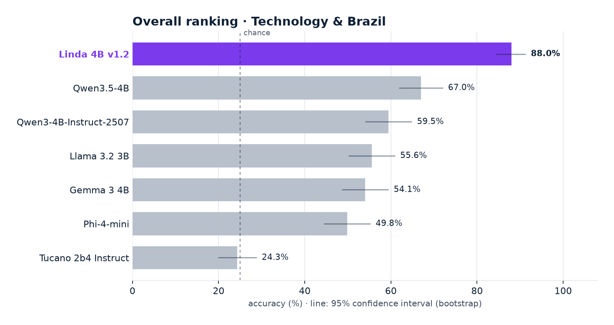
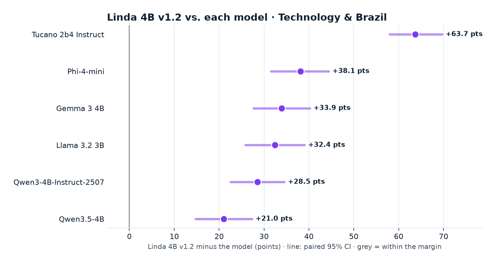
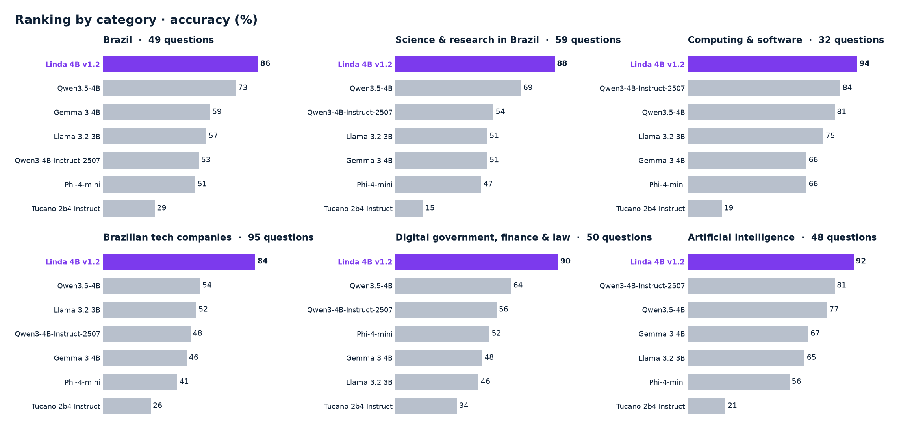
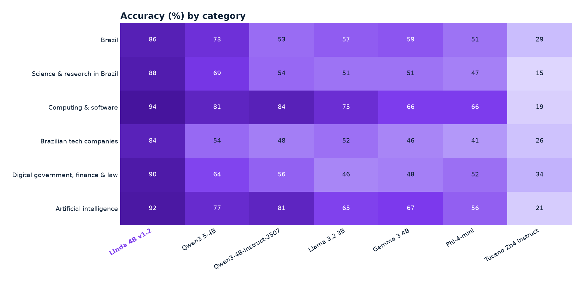
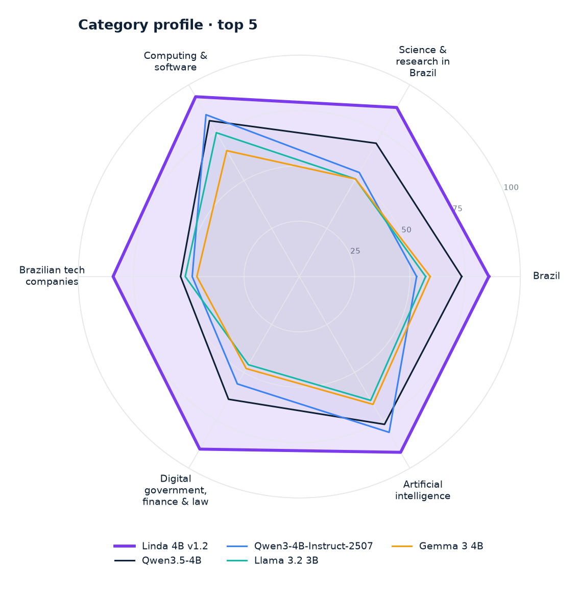
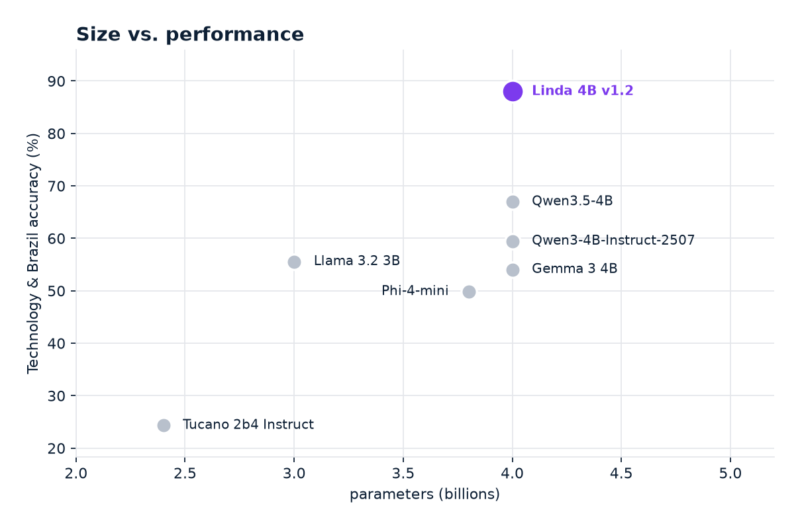
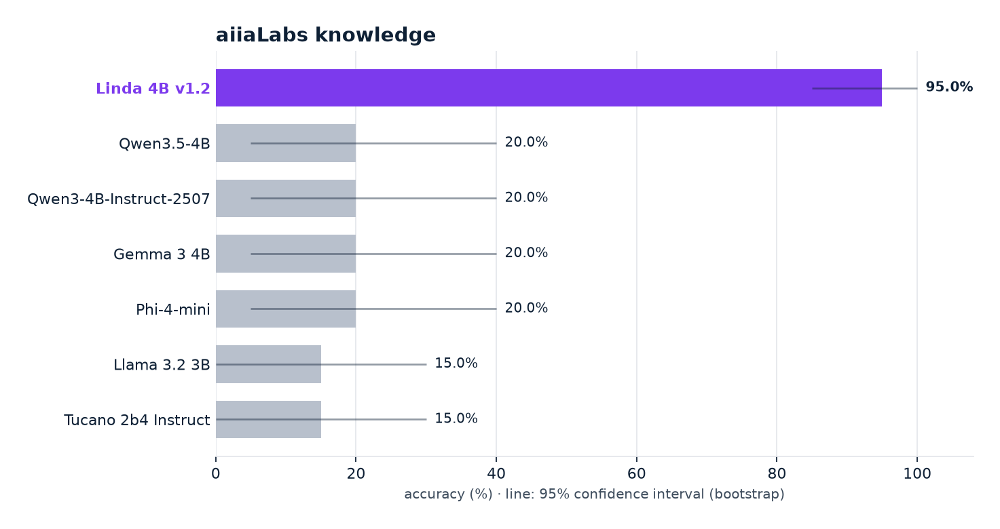
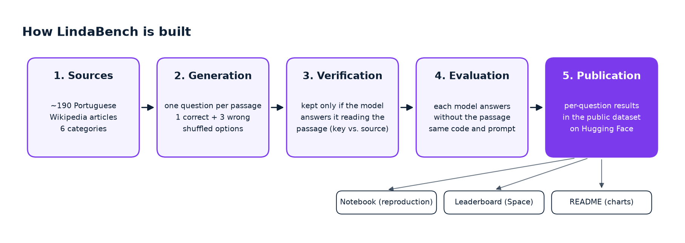
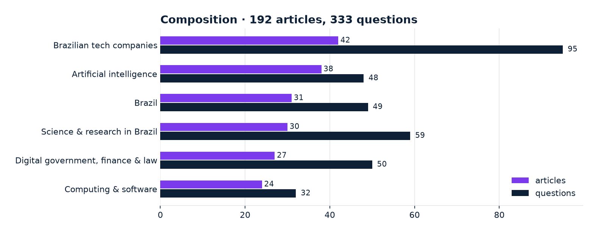

<div align="center">


# LindaBench

[Português](README.md) · **English** · [简体中文](README.zh-CN.md)

**Small language models in Portuguese on artificial intelligence, Brazilian technology and Brazil**

[](https://mybinder.org/v2/gh/aiiaLabs/LindaLLM-benchmark/HEAD?labpath=lindabench.ipynb)
[](https://colab.research.google.com/github/aiiaLabs/LindaLLM-benchmark/blob/main/lindabench.ipynb)
[](space/index.html)
[](data/)
  

</div>

**Linda** is the model family from [aiiaLabs](https://aiialabs.com.br). LindaBench compares **Linda 4B** with similarly sized open models on questions about artificial intelligence, Brazilian technology and Brazil.

All data are included in [`data/`](data/). The notebook recomputes scores and intervals locally, without downloading a Hugging Face dataset.



> **How to read this:** every question has 4 options, so random guessing scores **25%**. The best open model, Qwen3.5-4B, reaches **67.0%** (2.7× chance). Linda 4B v1.2 reaches **88.0%** (3.5× chance). Error bars are 95% confidence intervals: overlapping bars mean the difference is within the margin.

---

## Components

**aiiaLabs**

- **Linda family**: 4B, 8B, 27B and 180B models. This benchmark uses Linda 4B.
- **LindaBench**: code, notebook, [data](data/) and [leaderboard](space/index.html).

**Third-party software**

- **NumPy** and **pandas**: scores, bootstrap and tables.
- **Matplotlib**: charts.
- **Jupyter**: notebook.
- **mlx-lm**: reference evaluator.

---

## Table of Contents

- [Quickstart](#quickstart)
- [Results](#results)
- [Notebooks](#notebooks)
- [Run Locally](#run-locally)
- [What Is Measured](#what-is-measured)
- [Evaluated Models](#evaluated-models)
- [Evaluate Your Model](#evaluate-your-model)
- [Prerequisites](#prerequisites)
- [Citation](#citation)

---

## Quickstart

Open the notebook in **Binder** or **Colab** using the badges above and select **Run ▸ Run All Cells**. It reads the data included in the repository and recomputes tables and charts.

For the local leaderboard, run `python -m http.server 8000` in the repository root and open `http://localhost:8000/space/`.

---

## Results

- **Linda 4B v1.2** leads the overall ranking with **88.0%** on Technology & Brazil (95% CI: 84.4% – 91.3%).
- **Linda 4B v1.2** is **21.0 points ahead of** the best open model, Qwen3.5-4B (paired 95% CI: +14.7 to +27.3). The difference is statistically clear.
- Linda 4B v1.2 leads 6 of 6 categories: Brazil, Science & research in Brazil, Computing & software, Brazilian tech companies, Digital government, finance & law, Artificial intelligence.
- 7 models from 2.4B to 4B parameters, 333 questions, 6 categories, all evaluated on the same hardware with the same code.

### Overall Ranking

| # | Model | Organization | Parameters | **Technology & Brazil** | 95% CI |
|:---:|---|---|---:|---:|:---:|
| 1 | **Linda 4B v1.2** | aiiaLabs | 4B | **88.0%** | 84.4% – 91.3% |
| 2 | [Qwen3.5-4B](https://huggingface.co/Qwen/Qwen3.5-4B) | Alibaba | 4B | **67.0%** | 61.9% – 72.1% |
| 3 | [Qwen3-4B-Instruct-2507](https://huggingface.co/Qwen/Qwen3-4B-Instruct-2507) | Alibaba | 4B | **59.5%** | 54.1% – 64.9% |
| 4 | [Llama 3.2 3B](https://huggingface.co/meta-llama/Llama-3.2-3B-Instruct) | Meta | 3B | **55.6%** | 50.2% – 61.0% |
| 5 | [Gemma 3 4B](https://huggingface.co/google/gemma-3-4b-it) | Google | 4B | **54.1%** | 48.6% – 59.5% |
| 6 | [Phi-4-mini](https://huggingface.co/microsoft/Phi-4-mini-instruct) | Microsoft | 3.8B | **49.8%** | 44.4% – 55.3% |
| 7 | [Tucano 2b4 Instruct](https://huggingface.co/TucanoBR/Tucano-2b4-Instruct) | TucanoBR | 2.4B | **24.3%** | 19.8% – 28.8% |

<sub>333 multiple-choice questions · chance = 25% · bootstrap 95% CI · updated 2026-10-27</sub>

### Head-to-Head



<sub>Accuracy difference on the same questions. Purple: Linda is better beyond the margin; red: worse beyond the margin; grey: statistical tie.</sub>

### By Category





<details><summary><b>Brazil</b> · 49 questions · leader: Linda 4B v1.2 (85.7%)</summary>

| # | Model | Accuracy |
|:---:|---|---:|
| 1 | **Linda 4B v1.2** | 85.7% |
| 2 | Qwen3.5-4B | 73.5% |
| 3 | Gemma 3 4B | 59.2% |
| 4 | Llama 3.2 3B | 57.1% |
| 5 | Qwen3-4B-Instruct-2507 | 53.1% |
| 6 | Phi-4-mini | 51.0% |
| 7 | Tucano 2b4 Instruct | 28.6% |

</details>

<details><summary><b>Science & research in Brazil</b> · 59 questions · leader: Linda 4B v1.2 (88.1%)</summary>

| # | Model | Accuracy |
|:---:|---|---:|
| 1 | **Linda 4B v1.2** | 88.1% |
| 2 | Qwen3.5-4B | 69.5% |
| 3 | Qwen3-4B-Instruct-2507 | 54.2% |
| 4 | Llama 3.2 3B | 50.8% |
| 5 | Gemma 3 4B | 50.8% |
| 6 | Phi-4-mini | 47.5% |
| 7 | Tucano 2b4 Instruct | 15.3% |

</details>

<details><summary><b>Computing & software</b> · 32 questions · leader: Linda 4B v1.2 (93.8%)</summary>

| # | Model | Accuracy |
|:---:|---|---:|
| 1 | **Linda 4B v1.2** | 93.8% |
| 2 | Qwen3-4B-Instruct-2507 | 84.4% |
| 3 | Qwen3.5-4B | 81.2% |
| 4 | Llama 3.2 3B | 75.0% |
| 5 | Gemma 3 4B | 65.6% |
| 6 | Phi-4-mini | 65.6% |
| 7 | Tucano 2b4 Instruct | 18.8% |

</details>

<details><summary><b>Brazilian tech companies</b> · 95 questions · leader: Linda 4B v1.2 (84.2%)</summary>

| # | Model | Accuracy |
|:---:|---|---:|
| 1 | **Linda 4B v1.2** | 84.2% |
| 2 | Qwen3.5-4B | 53.7% |
| 3 | Llama 3.2 3B | 51.6% |
| 4 | Qwen3-4B-Instruct-2507 | 48.4% |
| 5 | Gemma 3 4B | 46.3% |
| 6 | Phi-4-mini | 41.1% |
| 7 | Tucano 2b4 Instruct | 26.3% |

</details>

<details><summary><b>Digital government, finance & law</b> · 50 questions · leader: Linda 4B v1.2 (90.0%)</summary>

| # | Model | Accuracy |
|:---:|---|---:|
| 1 | **Linda 4B v1.2** | 90.0% |
| 2 | Qwen3.5-4B | 64.0% |
| 3 | Qwen3-4B-Instruct-2507 | 56.0% |
| 4 | Phi-4-mini | 52.0% |
| 5 | Gemma 3 4B | 48.0% |
| 6 | Llama 3.2 3B | 46.0% |
| 7 | Tucano 2b4 Instruct | 34.0% |

</details>

<details><summary><b>Artificial intelligence</b> · 48 questions · leader: Linda 4B v1.2 (91.7%)</summary>

| # | Model | Accuracy |
|:---:|---|---:|
| 1 | **Linda 4B v1.2** | 91.7% |
| 2 | Qwen3-4B-Instruct-2507 | 81.2% |
| 3 | Qwen3.5-4B | 77.1% |
| 4 | Gemma 3 4B | 66.7% |
| 5 | Llama 3.2 3B | 64.6% |
| 6 | Phi-4-mini | 56.2% |
| 7 | Tucano 2b4 Instruct | 20.8% |

</details>

### Profile and Efficiency

| | |
|:---:|:---:|
|  |  |

<sub>Left: category profile of the top-scoring models. Right: accuracy against parameter count; higher and further left means more performance per parameter.</sub>

### aiiaLabs Knowledge

Knowledge about aiiaLabs and identity, with twenty questions per task. They are shown separately from the overall ranking.



| Model | aiiaLabs knowledge | Identity (Linda) |
|---|---:|---:|
| **Linda 4B v1.2** | 95.0% | 100.0% |
| Qwen3.5-4B | 20.0% | 0.0% |
| Qwen3-4B-Instruct-2507 | 20.0% | 0.0% |
| Gemma 3 4B | 20.0% | 0.0% |
| Phi-4-mini | 20.0% | 0.0% |
| Llama 3.2 3B | 15.0% | 0.0% |
| Tucano 2b4 Instruct | 15.0% | 0.0% |

---

## Notebooks

| # | Notebook | Description |
|---|---|---|
| 1 | [`lindabench.ipynb`](lindabench.ipynb) | Recomputes the ranking, intervals and categories; checks values against the local `summary.json`. Notebook text is in Portuguese. |

---

## Run Locally

```bash
git clone https://github.com/aiiaLabs/LindaLLM-benchmark.git
cd LindaLLM-benchmark
python -m venv .venv
source .venv/bin/activate
pip install -r requirements.txt
python scripts/refresh.py
python scripts/validate.py
jupyter notebook
```

`refresh.py` regenerates the data, all three READMEs and charts. No results are downloaded from an external service.

---

## What Is Measured



| Task | Questions |
|---|---:|
| **Technology & Brazil** | 333 |
| aiiaLabs knowledge | 20 |
| Identity | 20 |



Multiple-choice questions with 4 options in six categories; random guessing scores 25%. Intervals use 10,000 bootstrap resamples of the questions. Paired comparisons use the same questions for both models.

---

## Evaluated Models

| Model | Organization | Parameters | Weights |
|---|---|---:|---|
| **Linda 4B v1.2** | aiiaLabs | 4B | proprietary |
| [Qwen3-4B-Instruct-2507](https://huggingface.co/Qwen/Qwen3-4B-Instruct-2507) | Alibaba | 4B | open · [Qwen/Qwen3-4B-Instruct-2507](https://huggingface.co/Qwen/Qwen3-4B-Instruct-2507) |
| [Qwen3.5-4B](https://huggingface.co/Qwen/Qwen3.5-4B) | Alibaba | 4B | open · [Qwen/Qwen3.5-4B](https://huggingface.co/Qwen/Qwen3.5-4B) |
| [Gemma 3 4B](https://huggingface.co/google/gemma-3-4b-it) | Google | 4B | open · [google/gemma-3-4b-it](https://huggingface.co/google/gemma-3-4b-it) |
| [Llama 3.2 3B](https://huggingface.co/meta-llama/Llama-3.2-3B-Instruct) | Meta | 3B | open · [meta-llama/Llama-3.2-3B-Instruct](https://huggingface.co/meta-llama/Llama-3.2-3B-Instruct) |
| [Phi-4-mini](https://huggingface.co/microsoft/Phi-4-mini-instruct) | Microsoft | 3.8B | open · [microsoft/Phi-4-mini-instruct](https://huggingface.co/microsoft/Phi-4-mini-instruct) |
| [Tucano 2b4 Instruct](https://huggingface.co/TucanoBR/Tucano-2b4-Instruct) | TucanoBR | 2.4B | open · [TucanoBR/Tucano-2b4-Instruct](https://huggingface.co/TucanoBR/Tucano-2b4-Instruct) |

---

## Evaluate Your Model

The reference evaluator is in [`eval/run_mlx.py`](eval/run_mlx.py). Point it to the dataset directory with `LINDABENCH_LOCAL=<directory>` and install `mlx-lm` on an Apple Silicon Mac.

Contributions follow the [Code of Conduct](CODE_OF_CONDUCT.md).

---

## Prerequisites

| Component | Requirement |
|---|---|
| Notebook | Python 3.10+, CPU, ~1 GB RAM |
| Dependencies | `requirements.txt` |
| Data | Included in `data/`; no login or external data download |
| Leaderboard | Browser and local HTTP server |

---

## Citation

```bibtex
@misc{lindabench2026,
  title  = {LindaBench},
  author = {{aiiaLabs}},
  year   = {2026},
  url    = {https://github.com/aiiaLabs/LindaLLM-benchmark}
}
```

<div align="center">
<a href="https://aiialabs.com.br"></a>
<br>
<sub>aiiaLabs · LindaBench</sub>
</div>
