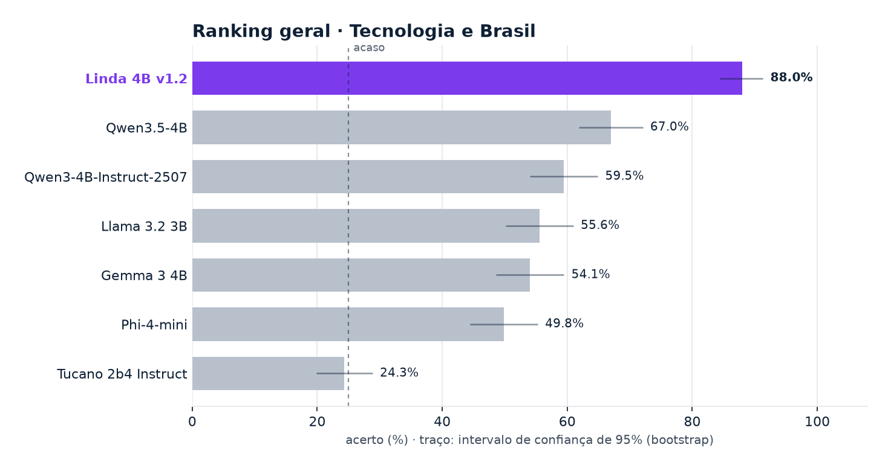
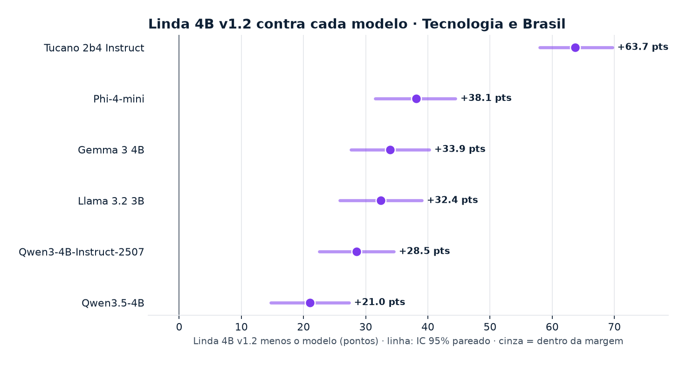
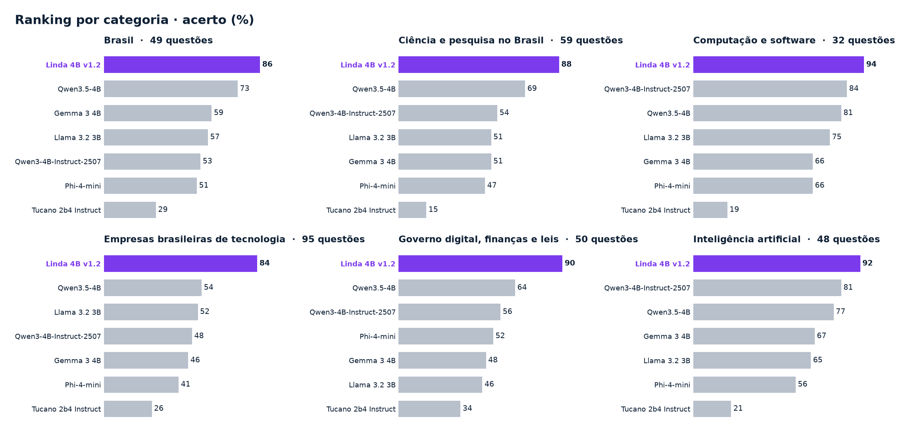
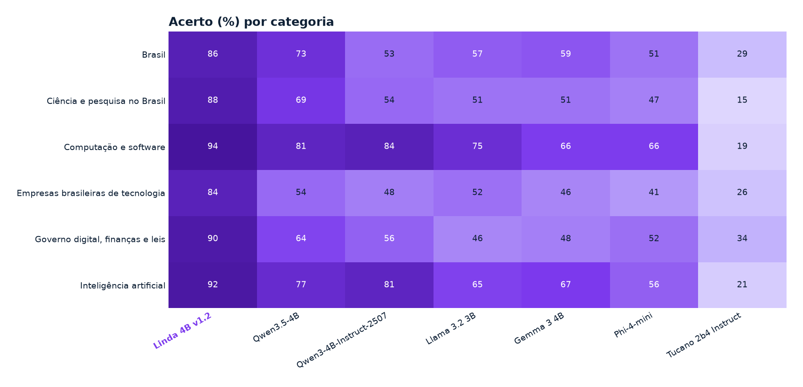
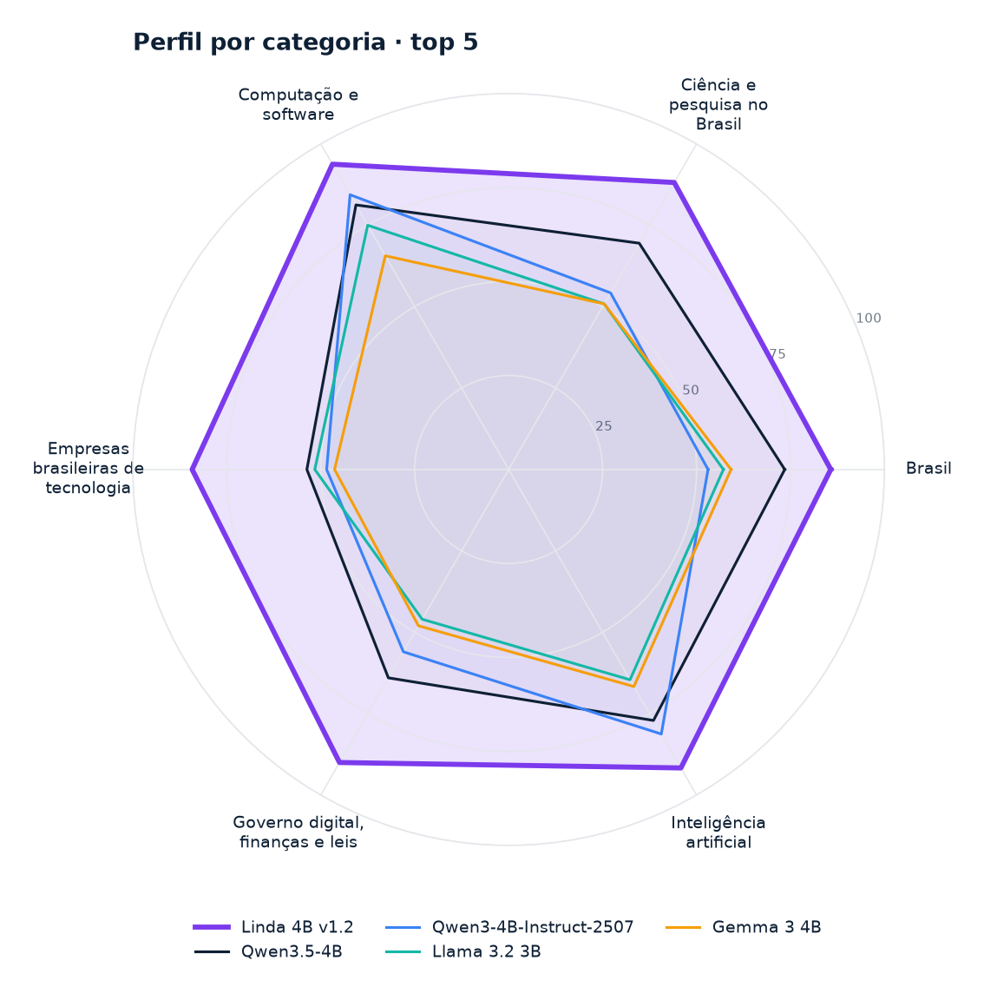
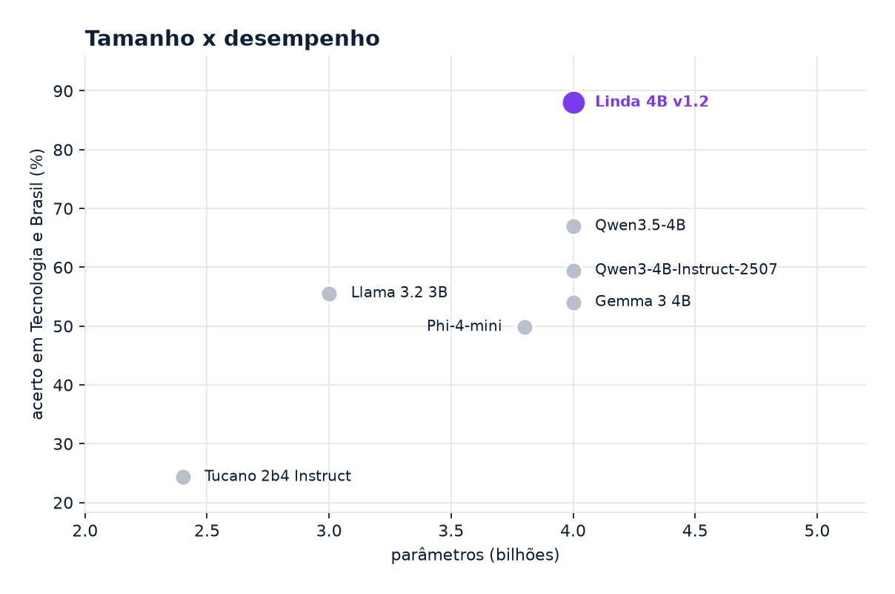
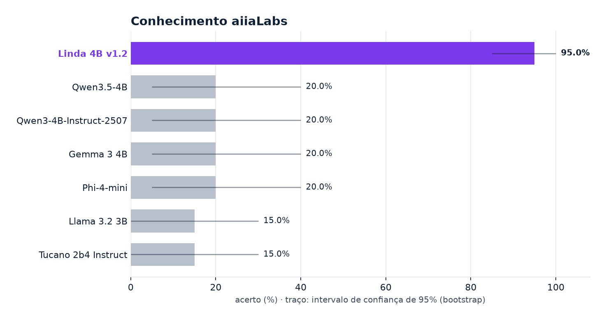
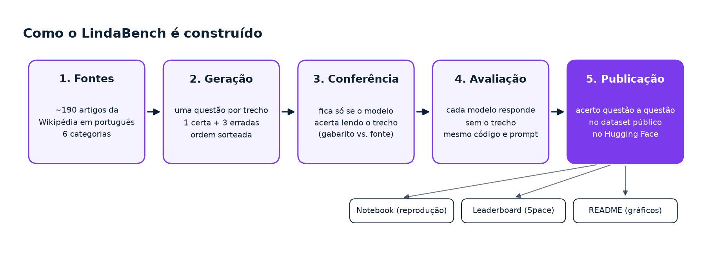
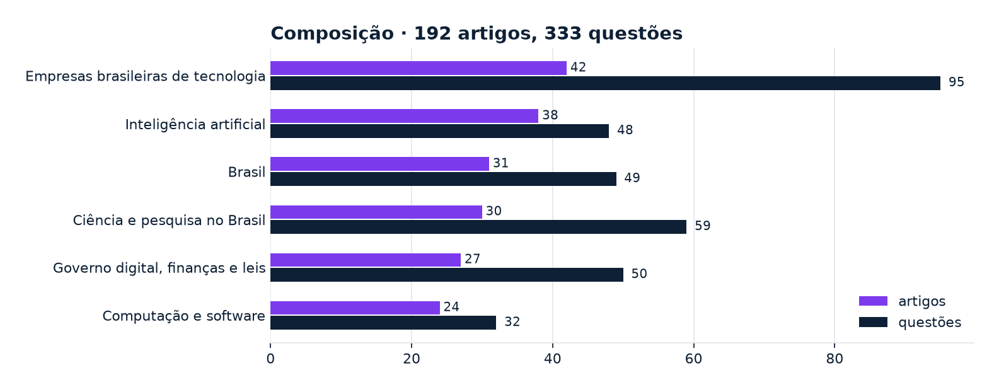

<div align="center">


# LindaBench

**Português** · [English](README.en.md) · [简体中文](README.zh-CN.md)

**Modelos de linguagem pequenos em português sobre inteligência artificial, tecnologia brasileira e Brasil**

[](https://mybinder.org/v2/gh/aiiaLabs/LindaLLM-benchmark/HEAD?labpath=lindabench.ipynb)
[](https://colab.research.google.com/github/aiiaLabs/LindaLLM-benchmark/blob/main/lindabench.ipynb)
[](space/index.html)
[](data/)
  

</div>

A **Linda** é a família de modelos da [aiiaLabs](https://aiialabs.com.br). O LindaBench compara a **Linda 4B** com modelos abertos de tamanho semelhante em perguntas sobre inteligência artificial, tecnologia brasileira e Brasil.

Os dados estão em [`data/`](data/). O notebook recalcula as notas e os intervalos localmente, sem baixar o dataset do Hugging Face.



> **Como ler:** cada questão tem 4 alternativas, então responder ao acaso dá **25%**. O melhor modelo aberto, Qwen3.5-4B, chega a **67.0%** (2.7× o acaso). A Linda 4B v1.2 chega a **88.0%** (3.5× o acaso). As barras de erro são o intervalo de confiança de 95%: barras que se sobrepõem indicam diferença dentro da margem.

---

## Componentes

**aiiaLabs**

- **Família Linda**: modelos de 4B, 8B, 27B e 180B parâmetros. Este benchmark usa a Linda 4B.
- **LindaBench**: código, notebook, [dados](data/) e [leaderboard](space/index.html).

**Software de terceiros**

- **NumPy** e **pandas**: notas, bootstrap e tabelas.
- **Matplotlib**: gráficos.
- **Jupyter**: notebook.
- **mlx-lm**: avaliador de referência.

---

## Sumário

- [Quickstart](#quickstart)
- [Resultados](#resultados)
- [Notebooks](#notebooks)
- [Rodar localmente](#rodar-localmente)
- [O que é medido](#o-que-é-medido)
- [Modelos avaliados](#modelos-avaliados)
- [Avalie o seu modelo](#avalie-o-seu-modelo)
- [Pré-requisitos](#pré-requisitos)
- [Como citar](#como-citar)

---

## Quickstart

Abra o notebook no **Binder** ou **Colab** pelos badges acima e escolha **Run ▸ Run All Cells**. Ele lê os dados incluídos no repositório e recalcula as tabelas e os gráficos.

Para abrir o leaderboard localmente, execute `python -m http.server 8000` na raiz e acesse `http://localhost:8000/space/`.

---

## Resultados

- **Linda 4B v1.2** lidera o ranking geral com **88.0%** em Tecnologia e Brasil (IC 95%: 84.4% – 91.3%).
- A **Linda 4B v1.2** fica **21.0 pontos à frente do** melhor modelo aberto, Qwen3.5-4B (IC 95% pareado: +14.7 a +27.3). A diferença é estatisticamente clara.
- A Linda 4B v1.2 lidera 6 de 6 categorias: Brasil, Ciência e pesquisa no Brasil, Computação e software, Empresas brasileiras de tecnologia, Governo digital, finanças e leis, Inteligência artificial.
- 7 modelos de 2.4B a 4B parâmetros, 333 questões, 6 categorias, todos avaliados no mesmo hardware e com o mesmo código.

### Ranking geral

| # | Modelo | Organização | Parâmetros | **Tecnologia e Brasil** | IC 95% |
|:---:|---|---|---:|---:|:---:|
| 1 | **Linda 4B v1.2** | aiiaLabs | 4B | **88.0%** | 84.4% – 91.3% |
| 2 | [Qwen3.5-4B](https://huggingface.co/Qwen/Qwen3.5-4B) | Alibaba | 4B | **67.0%** | 61.9% – 72.1% |
| 3 | [Qwen3-4B-Instruct-2507](https://huggingface.co/Qwen/Qwen3-4B-Instruct-2507) | Alibaba | 4B | **59.5%** | 54.1% – 64.9% |
| 4 | [Llama 3.2 3B](https://huggingface.co/meta-llama/Llama-3.2-3B-Instruct) | Meta | 3B | **55.6%** | 50.2% – 61.0% |
| 5 | [Gemma 3 4B](https://huggingface.co/google/gemma-3-4b-it) | Google | 4B | **54.1%** | 48.6% – 59.5% |
| 6 | [Phi-4-mini](https://huggingface.co/microsoft/Phi-4-mini-instruct) | Microsoft | 3.8B | **49.8%** | 44.4% – 55.3% |
| 7 | [Tucano 2b4 Instruct](https://huggingface.co/TucanoBR/Tucano-2b4-Instruct) | TucanoBR | 2.4B | **24.3%** | 19.8% – 28.8% |

<sub>333 questões de múltipla escolha · acaso = 25% · IC 95% por bootstrap · atualizado em 2026-10-27</sub>

### Comparação direta



<sub>Diferença no acerto, nas mesmas questões. Roxo: a Linda é melhor com margem; vermelho: pior com margem; cinza: empate técnico.</sub>

### Por categoria





<details><summary><b>Brasil</b> · 49 questões · líder: Linda 4B v1.2 (85.7%)</summary>

| # | Modelo | Acerto |
|:---:|---|---:|
| 1 | **Linda 4B v1.2** | 85.7% |
| 2 | Qwen3.5-4B | 73.5% |
| 3 | Gemma 3 4B | 59.2% |
| 4 | Llama 3.2 3B | 57.1% |
| 5 | Qwen3-4B-Instruct-2507 | 53.1% |
| 6 | Phi-4-mini | 51.0% |
| 7 | Tucano 2b4 Instruct | 28.6% |

</details>

<details><summary><b>Ciência e pesquisa no Brasil</b> · 59 questões · líder: Linda 4B v1.2 (88.1%)</summary>

| # | Modelo | Acerto |
|:---:|---|---:|
| 1 | **Linda 4B v1.2** | 88.1% |
| 2 | Qwen3.5-4B | 69.5% |
| 3 | Qwen3-4B-Instruct-2507 | 54.2% |
| 4 | Llama 3.2 3B | 50.8% |
| 5 | Gemma 3 4B | 50.8% |
| 6 | Phi-4-mini | 47.5% |
| 7 | Tucano 2b4 Instruct | 15.3% |

</details>

<details><summary><b>Computação e software</b> · 32 questões · líder: Linda 4B v1.2 (93.8%)</summary>

| # | Modelo | Acerto |
|:---:|---|---:|
| 1 | **Linda 4B v1.2** | 93.8% |
| 2 | Qwen3-4B-Instruct-2507 | 84.4% |
| 3 | Qwen3.5-4B | 81.2% |
| 4 | Llama 3.2 3B | 75.0% |
| 5 | Gemma 3 4B | 65.6% |
| 6 | Phi-4-mini | 65.6% |
| 7 | Tucano 2b4 Instruct | 18.8% |

</details>

<details><summary><b>Empresas brasileiras de tecnologia</b> · 95 questões · líder: Linda 4B v1.2 (84.2%)</summary>

| # | Modelo | Acerto |
|:---:|---|---:|
| 1 | **Linda 4B v1.2** | 84.2% |
| 2 | Qwen3.5-4B | 53.7% |
| 3 | Llama 3.2 3B | 51.6% |
| 4 | Qwen3-4B-Instruct-2507 | 48.4% |
| 5 | Gemma 3 4B | 46.3% |
| 6 | Phi-4-mini | 41.1% |
| 7 | Tucano 2b4 Instruct | 26.3% |

</details>

<details><summary><b>Governo digital, finanças e leis</b> · 50 questões · líder: Linda 4B v1.2 (90.0%)</summary>

| # | Modelo | Acerto |
|:---:|---|---:|
| 1 | **Linda 4B v1.2** | 90.0% |
| 2 | Qwen3.5-4B | 64.0% |
| 3 | Qwen3-4B-Instruct-2507 | 56.0% |
| 4 | Phi-4-mini | 52.0% |
| 5 | Gemma 3 4B | 48.0% |
| 6 | Llama 3.2 3B | 46.0% |
| 7 | Tucano 2b4 Instruct | 34.0% |

</details>

<details><summary><b>Inteligência artificial</b> · 48 questões · líder: Linda 4B v1.2 (91.7%)</summary>

| # | Modelo | Acerto |
|:---:|---|---:|
| 1 | **Linda 4B v1.2** | 91.7% |
| 2 | Qwen3-4B-Instruct-2507 | 81.2% |
| 3 | Qwen3.5-4B | 77.1% |
| 4 | Gemma 3 4B | 66.7% |
| 5 | Llama 3.2 3B | 64.6% |
| 6 | Phi-4-mini | 56.2% |
| 7 | Tucano 2b4 Instruct | 20.8% |

</details>

### Perfil e eficiência

| | |
|:---:|:---:|
|  |  |

<sub>À esquerda, o perfil dos modelos com maior nota em cada categoria. À direita, o acerto em função do número de parâmetros: quanto mais alto e à esquerda, mais o modelo entrega pelo tamanho.</sub>

### Conhecimento aiiaLabs

Conhecimento sobre a aiiaLabs e identidade, com vinte perguntas por tarefa. São apresentados separadamente do ranking geral.



| Modelo | Conhecimento aiiaLabs | Identidade (Linda) |
|---|---:|---:|
| **Linda 4B v1.2** | 95.0% | 100.0% |
| Qwen3.5-4B | 20.0% | 0.0% |
| Qwen3-4B-Instruct-2507 | 20.0% | 0.0% |
| Gemma 3 4B | 20.0% | 0.0% |
| Phi-4-mini | 20.0% | 0.0% |
| Llama 3.2 3B | 15.0% | 0.0% |
| Tucano 2b4 Instruct | 15.0% | 0.0% |

---

## Notebooks

| # | Notebook | Descrição |
|---|---|---|
| 1 | [`lindabench.ipynb`](lindabench.ipynb) | Recalcula o ranking, os intervalos e as categorias; confere os valores com o `summary.json` local. |

---

## Rodar localmente

```bash
git clone https://github.com/aiiaLabs/LindaLLM-benchmark.git
cd LindaLLM-benchmark
python -m venv .venv
source .venv/bin/activate
pip install -r requirements.txt
python scripts/refresh.py
python scripts/validate.py
jupyter notebook
```

`refresh.py` regenera os dados, os três READMEs e os gráficos. Nenhum resultado é baixado de um serviço externo.

---

## O que é medido



| Tarefa | Questões |
|---|---:|
| **Tecnologia e Brasil** | 333 |
| Conhecimento aiiaLabs | 20 |
| Identidade | 20 |



Questões de múltipla escolha com 4 alternativas em seis categorias; responder ao acaso dá 25%. Os intervalos usam bootstrap com 10.000 reamostragens das questões. A comparação pareada usa as mesmas questões para os dois modelos.

---

## Modelos avaliados

| Modelo | Organização | Parâmetros | Pesos |
|---|---|---:|---|
| **Linda 4B v1.2** | aiiaLabs | 4B | proprietário |
| [Qwen3-4B-Instruct-2507](https://huggingface.co/Qwen/Qwen3-4B-Instruct-2507) | Alibaba | 4B | abertos · [Qwen/Qwen3-4B-Instruct-2507](https://huggingface.co/Qwen/Qwen3-4B-Instruct-2507) |
| [Qwen3.5-4B](https://huggingface.co/Qwen/Qwen3.5-4B) | Alibaba | 4B | abertos · [Qwen/Qwen3.5-4B](https://huggingface.co/Qwen/Qwen3.5-4B) |
| [Gemma 3 4B](https://huggingface.co/google/gemma-3-4b-it) | Google | 4B | abertos · [google/gemma-3-4b-it](https://huggingface.co/google/gemma-3-4b-it) |
| [Llama 3.2 3B](https://huggingface.co/meta-llama/Llama-3.2-3B-Instruct) | Meta | 3B | abertos · [meta-llama/Llama-3.2-3B-Instruct](https://huggingface.co/meta-llama/Llama-3.2-3B-Instruct) |
| [Phi-4-mini](https://huggingface.co/microsoft/Phi-4-mini-instruct) | Microsoft | 3.8B | abertos · [microsoft/Phi-4-mini-instruct](https://huggingface.co/microsoft/Phi-4-mini-instruct) |
| [Tucano 2b4 Instruct](https://huggingface.co/TucanoBR/Tucano-2b4-Instruct) | TucanoBR | 2.4B | abertos · [TucanoBR/Tucano-2b4-Instruct](https://huggingface.co/TucanoBR/Tucano-2b4-Instruct) |

---

## Avalie o seu modelo

O avaliador de referência está em [`eval/run_mlx.py`](eval/run_mlx.py). Indique a pasta do dataset com `LINDABENCH_LOCAL=<pasta>` e instale `mlx-lm` num Mac com Apple Silicon.

O [Código de Conduta](CODE_OF_CONDUCT.md) se aplica a contribuições.

---

## Pré-requisitos

| Componente | Requisito |
|---|---|
| Notebook | Python 3.10+, CPU, ~1 GB de RAM |
| Dependências | `requirements.txt` |
| Dados | Incluídos em `data/`; sem login ou download externo |
| Leaderboard | Navegador e um servidor HTTP local |

---

## Como citar

```bibtex
@misc{lindabench2026,
  title  = {LindaBench},
  author = {{aiiaLabs}},
  year   = {2026},
  url    = {https://github.com/aiiaLabs/LindaLLM-benchmark}
}
```

<div align="center">
<a href="https://aiialabs.com.br"></a>
<br>
<sub>aiiaLabs · LindaBench</sub>
</div>
