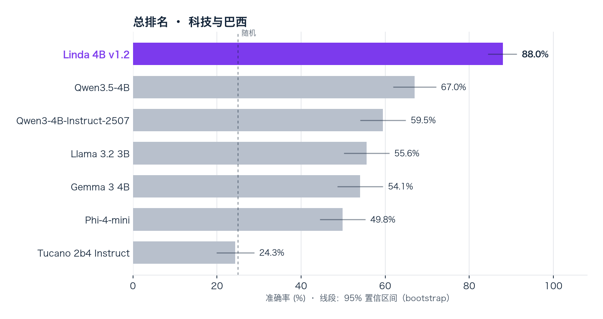
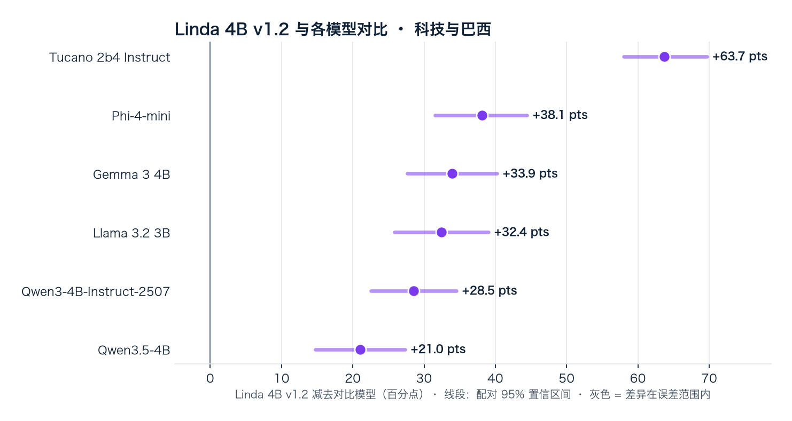
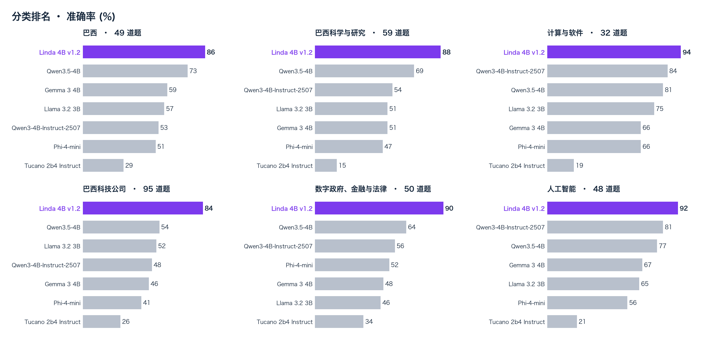
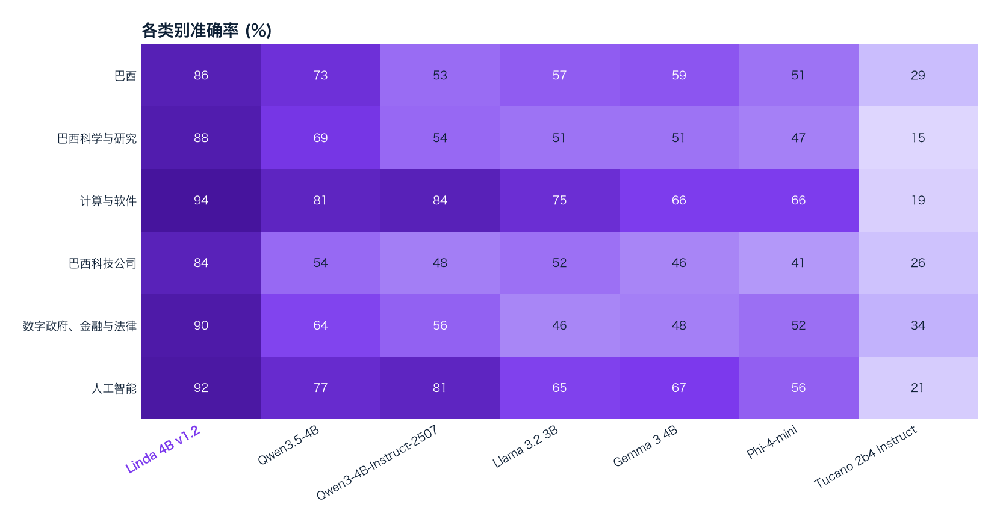
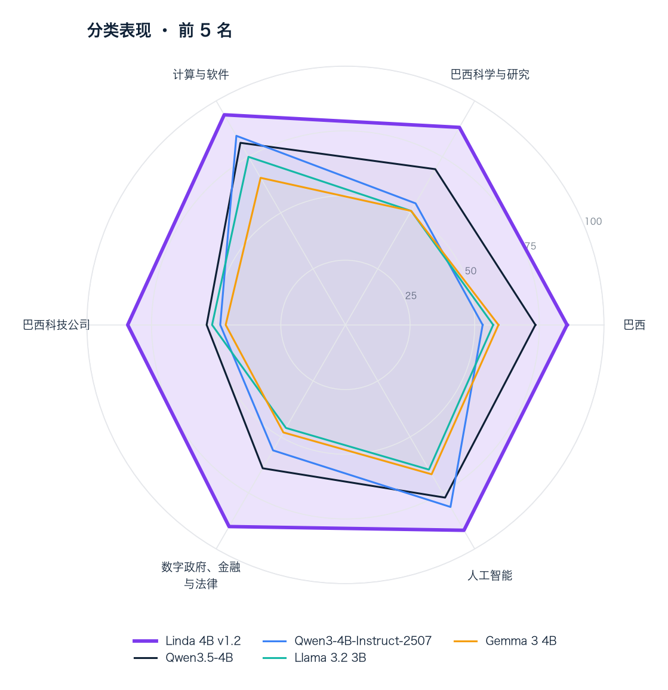
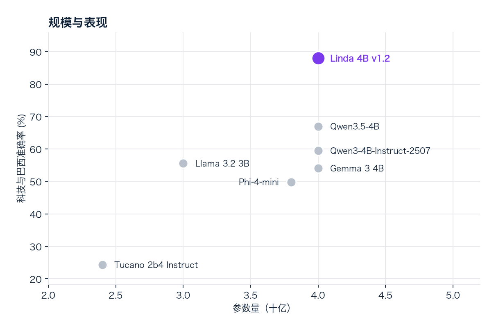
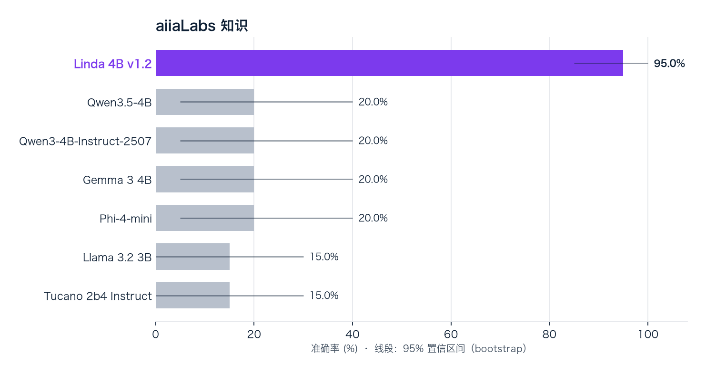
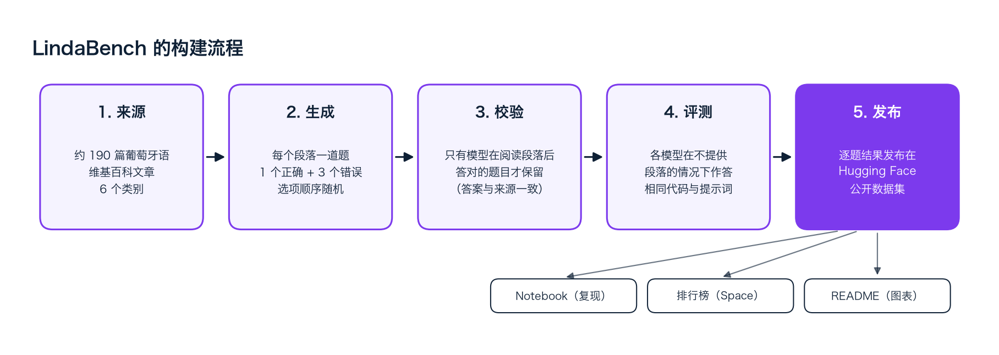
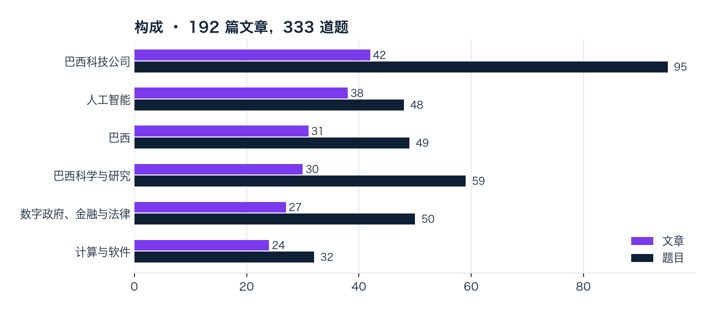

<div align="center">


# LindaBench

[Português](README.md) · [English](README.en.md) · **简体中文**

**葡萄牙语小型语言模型评测：人工智能、巴西科技与巴西**

[](https://mybinder.org/v2/gh/aiiaLabs/LindaLLM-benchmark/HEAD?labpath=lindabench.ipynb)
[](https://colab.research.google.com/github/aiiaLabs/LindaLLM-benchmark/blob/main/lindabench.ipynb)
[](space/index.html)
[](data/)
  

</div>

**Linda** 是 [aiiaLabs](https://aiialabs.com.br) 的模型系列。LindaBench 在人工智能、巴西科技和巴西相关问题上，将 **Linda 4B** 与规模相近的开源模型进行比较。

所有数据均包含在 [`data/`](data/) 中。Notebook 在本地重新计算分数和区间，无需下载 Hugging Face 数据集。



> **如何解读：** 每道题有 4 个选项，随机作答的准确率为 **25%**。最佳开源模型 Qwen3.5-4B 达到 **67.0%**（随机水平的 2.7 倍）。Linda 4B v1.2 达到 **88.0%**（随机水平的 3.5 倍）。误差线为 95% 置信区间：误差线重叠表示差异在误差范围内。

---

## 组成部分

**aiiaLabs**

- **Linda 系列**：4B、8B、27B 和 180B 模型。本基准使用 Linda 4B。
- **LindaBench**：代码、notebook、[数据](data/)和[排行榜](space/index.html)。

**第三方软件**

- **NumPy** 与 **pandas**：分数、bootstrap 与表格。
- **Matplotlib**：图表。
- **Jupyter**：notebook。
- **mlx-lm**：参考评测器。

---

## 目录

- [快速开始](#快速开始)
- [评测结果](#评测结果)
- [Notebook](#notebook)
- [本地运行](#本地运行)
- [评测内容](#评测内容)
- [参评模型](#参评模型)
- [评测你的模型](#评测你的模型)
- [环境要求](#环境要求)
- [引用](#引用)

---

## 快速开始

通过上方徽章在 **Binder** 或 **Colab** 打开 notebook，选择 **Run ▸ Run All Cells**。Notebook 读取仓库内的数据，重新计算表格和图表。

本地排行榜：在仓库根目录运行 `python -m http.server 8000`，打开 `http://localhost:8000/space/`。

---

## 评测结果

- **Linda 4B v1.2** 以 **88.0%** 的科技与巴西准确率位列总排名第一（95% 置信区间：84.4% – 91.3%）。
- **Linda 4B v1.2** 领先最佳开源模型 Qwen3.5-4B **21.0 个百分点**（配对 95% 置信区间：+14.7 至 +27.3）。该差异在统计上显著。
- Linda 4B v1.2 在 6 个类别中的 6 个领先：巴西、巴西科学与研究、计算与软件、巴西科技公司、数字政府、金融与法律、人工智能。
- 共 7 个模型，参数量 2.4B 至 4B，333 道题，6 个类别，均在相同硬件上以相同代码评测。

### 总排名

| # | 模型 | 机构 | 参数量 | **科技与巴西** | 95% 置信区间 |
|:---:|---|---|---:|---:|:---:|
| 1 | **Linda 4B v1.2** | aiiaLabs | 4B | **88.0%** | 84.4% – 91.3% |
| 2 | [Qwen3.5-4B](https://huggingface.co/Qwen/Qwen3.5-4B) | Alibaba | 4B | **67.0%** | 61.9% – 72.1% |
| 3 | [Qwen3-4B-Instruct-2507](https://huggingface.co/Qwen/Qwen3-4B-Instruct-2507) | Alibaba | 4B | **59.5%** | 54.1% – 64.9% |
| 4 | [Llama 3.2 3B](https://huggingface.co/meta-llama/Llama-3.2-3B-Instruct) | Meta | 3B | **55.6%** | 50.2% – 61.0% |
| 5 | [Gemma 3 4B](https://huggingface.co/google/gemma-3-4b-it) | Google | 4B | **54.1%** | 48.6% – 59.5% |
| 6 | [Phi-4-mini](https://huggingface.co/microsoft/Phi-4-mini-instruct) | Microsoft | 3.8B | **49.8%** | 44.4% – 55.3% |
| 7 | [Tucano 2b4 Instruct](https://huggingface.co/TucanoBR/Tucano-2b4-Instruct) | TucanoBR | 2.4B | **24.3%** | 19.8% – 28.8% |

<sub>333 道多项选择题 · 随机水平 = 25% · bootstrap 95% 置信区间 · 更新于 2026-10-27</sub>

### 直接对比



<sub>同一批题目上的准确率差异。紫色：Linda 显著更好；红色：显著更差；灰色：差异在误差范围内。</sub>

### 分类结果





<details><summary><b>巴西</b> · 49 道题 · 第一名：Linda 4B v1.2（85.7%）</summary>

| # | 模型 | 准确率 |
|:---:|---|---:|
| 1 | **Linda 4B v1.2** | 85.7% |
| 2 | Qwen3.5-4B | 73.5% |
| 3 | Gemma 3 4B | 59.2% |
| 4 | Llama 3.2 3B | 57.1% |
| 5 | Qwen3-4B-Instruct-2507 | 53.1% |
| 6 | Phi-4-mini | 51.0% |
| 7 | Tucano 2b4 Instruct | 28.6% |

</details>

<details><summary><b>巴西科学与研究</b> · 59 道题 · 第一名：Linda 4B v1.2（88.1%）</summary>

| # | 模型 | 准确率 |
|:---:|---|---:|
| 1 | **Linda 4B v1.2** | 88.1% |
| 2 | Qwen3.5-4B | 69.5% |
| 3 | Qwen3-4B-Instruct-2507 | 54.2% |
| 4 | Llama 3.2 3B | 50.8% |
| 5 | Gemma 3 4B | 50.8% |
| 6 | Phi-4-mini | 47.5% |
| 7 | Tucano 2b4 Instruct | 15.3% |

</details>

<details><summary><b>计算与软件</b> · 32 道题 · 第一名：Linda 4B v1.2（93.8%）</summary>

| # | 模型 | 准确率 |
|:---:|---|---:|
| 1 | **Linda 4B v1.2** | 93.8% |
| 2 | Qwen3-4B-Instruct-2507 | 84.4% |
| 3 | Qwen3.5-4B | 81.2% |
| 4 | Llama 3.2 3B | 75.0% |
| 5 | Gemma 3 4B | 65.6% |
| 6 | Phi-4-mini | 65.6% |
| 7 | Tucano 2b4 Instruct | 18.8% |

</details>

<details><summary><b>巴西科技公司</b> · 95 道题 · 第一名：Linda 4B v1.2（84.2%）</summary>

| # | 模型 | 准确率 |
|:---:|---|---:|
| 1 | **Linda 4B v1.2** | 84.2% |
| 2 | Qwen3.5-4B | 53.7% |
| 3 | Llama 3.2 3B | 51.6% |
| 4 | Qwen3-4B-Instruct-2507 | 48.4% |
| 5 | Gemma 3 4B | 46.3% |
| 6 | Phi-4-mini | 41.1% |
| 7 | Tucano 2b4 Instruct | 26.3% |

</details>

<details><summary><b>数字政府、金融与法律</b> · 50 道题 · 第一名：Linda 4B v1.2（90.0%）</summary>

| # | 模型 | 准确率 |
|:---:|---|---:|
| 1 | **Linda 4B v1.2** | 90.0% |
| 2 | Qwen3.5-4B | 64.0% |
| 3 | Qwen3-4B-Instruct-2507 | 56.0% |
| 4 | Phi-4-mini | 52.0% |
| 5 | Gemma 3 4B | 48.0% |
| 6 | Llama 3.2 3B | 46.0% |
| 7 | Tucano 2b4 Instruct | 34.0% |

</details>

<details><summary><b>人工智能</b> · 48 道题 · 第一名：Linda 4B v1.2（91.7%）</summary>

| # | 模型 | 准确率 |
|:---:|---|---:|
| 1 | **Linda 4B v1.2** | 91.7% |
| 2 | Qwen3-4B-Instruct-2507 | 81.2% |
| 3 | Qwen3.5-4B | 77.1% |
| 4 | Gemma 3 4B | 66.7% |
| 5 | Llama 3.2 3B | 64.6% |
| 6 | Phi-4-mini | 56.2% |
| 7 | Tucano 2b4 Instruct | 20.8% |

</details>

### 表现与效率

| | |
|:---:|:---:|
|  |  |

<sub>左图：得分最高模型的分类表现。右图：准确率与参数量的关系，越靠上、越靠左，单位参数的表现越好。</sub>

### aiiaLabs 知识

aiiaLabs 知识与身份，每项任务二十道题，单独展示，不计入总排名。



| 模型 | aiiaLabs 知识 | 身份（Linda） |
|---|---:|---:|
| **Linda 4B v1.2** | 95.0% | 100.0% |
| Qwen3.5-4B | 20.0% | 0.0% |
| Qwen3-4B-Instruct-2507 | 20.0% | 0.0% |
| Gemma 3 4B | 20.0% | 0.0% |
| Phi-4-mini | 20.0% | 0.0% |
| Llama 3.2 3B | 15.0% | 0.0% |
| Tucano 2b4 Instruct | 15.0% | 0.0% |

---

## Notebook

| # | Notebook | 说明 |
|---|---|---|
| 1 | [`lindabench.ipynb`](lindabench.ipynb) | 重新计算排名、区间和分类结果，核验本地 `summary.json`。正文为葡萄牙语。 |

---

## 本地运行

```bash
git clone https://github.com/aiiaLabs/LindaLLM-benchmark.git
cd LindaLLM-benchmark
python -m venv .venv
source .venv/bin/activate
pip install -r requirements.txt
python scripts/refresh.py
python scripts/validate.py
jupyter notebook
```

`refresh.py` 重新生成数据、三种语言的 README 和图表。不从外部服务下载结果。

---

## 评测内容



| 任务 | 题目 |
|---|---:|
| **科技与巴西** | 333 |
| aiiaLabs 知识 | 20 |
| 身份 | 20 |



六个类别的四选一选择题，随机作答为 25%。区间对题目进行 10,000 次 bootstrap 重采样。配对比较对两个模型使用相同的题目。

---

## 参评模型

| 模型 | 机构 | 参数量 | 权重 |
|---|---|---:|---|
| **Linda 4B v1.2** | aiiaLabs | 4B | 专有 |
| [Qwen3-4B-Instruct-2507](https://huggingface.co/Qwen/Qwen3-4B-Instruct-2507) | Alibaba | 4B | 开源 · [Qwen/Qwen3-4B-Instruct-2507](https://huggingface.co/Qwen/Qwen3-4B-Instruct-2507) |
| [Qwen3.5-4B](https://huggingface.co/Qwen/Qwen3.5-4B) | Alibaba | 4B | 开源 · [Qwen/Qwen3.5-4B](https://huggingface.co/Qwen/Qwen3.5-4B) |
| [Gemma 3 4B](https://huggingface.co/google/gemma-3-4b-it) | Google | 4B | 开源 · [google/gemma-3-4b-it](https://huggingface.co/google/gemma-3-4b-it) |
| [Llama 3.2 3B](https://huggingface.co/meta-llama/Llama-3.2-3B-Instruct) | Meta | 3B | 开源 · [meta-llama/Llama-3.2-3B-Instruct](https://huggingface.co/meta-llama/Llama-3.2-3B-Instruct) |
| [Phi-4-mini](https://huggingface.co/microsoft/Phi-4-mini-instruct) | Microsoft | 3.8B | 开源 · [microsoft/Phi-4-mini-instruct](https://huggingface.co/microsoft/Phi-4-mini-instruct) |
| [Tucano 2b4 Instruct](https://huggingface.co/TucanoBR/Tucano-2b4-Instruct) | TucanoBR | 2.4B | 开源 · [TucanoBR/Tucano-2b4-Instruct](https://huggingface.co/TucanoBR/Tucano-2b4-Instruct) |

---

## 评测你的模型

参考评测器位于 [`eval/run_mlx.py`](eval/run_mlx.py)。通过 `LINDABENCH_LOCAL=<目录>` 指定数据集目录，并在 Apple Silicon Mac 上安装 `mlx-lm`。

贡献须遵守[行为准则](CODE_OF_CONDUCT.md)。

---

## 环境要求

| 组件 | 要求 |
|---|---|
| Notebook | Python 3.10+，CPU，约 1 GB 内存 |
| 依赖 | `requirements.txt` |
| 数据 | 包含在 `data/` 中，无需登录或下载外部数据 |
| 排行榜 | 浏览器与本地 HTTP 服务器 |

---

## 引用

```bibtex
@misc{lindabench2026,
  title  = {LindaBench},
  author = {{aiiaLabs}},
  year   = {2026},
  url    = {https://github.com/aiiaLabs/LindaLLM-benchmark}
}
```

<div align="center">
<a href="https://aiialabs.com.br"></a>
<br>
<sub>aiiaLabs · LindaBench</sub>
</div>
